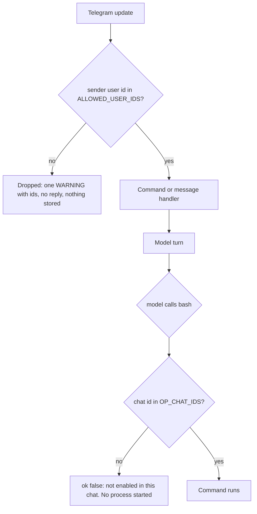

# Access control (issue #35)

Who may use the bot, and in which chats the `bash` tool works. Added 2026-10-12. The settings are in `.env`; the code is `src/access.py` plus the gate in `src/client.py`.

## The two settings

| Variable | Meaning | Empty or missing |
|---|---|---|
| `ALLOWED_USER_IDS` | Numeric Telegram **user** ids of the people who may use the bot, comma separated. | **The bot refuses to start.** |
| `OP_CHAT_IDS` | Numeric **chat** ids where the `bash` tool is allowed to run, comma separated. In a private chat the chat id equals the user id. A group id is negative. | `bash` is off everywhere. |

Entries may have spaces and a trailing comma. A bad entry stops the bot at startup with a message naming it (usernames, `@alice`, text, or a negative number in `ALLOWED_USER_IDS` all fail). A failed load keeps the previous lists.

Numeric ids, not usernames, because a username can be changed or released and claimed by someone else, and some people have none (#38). The old `/sql` command used a username list.

## How a request is checked

1. **The gate** (`client.gate`, a `TypeHandler` in handler group -1) runs before every other handler. A stranger gets no reply, because a reply would confirm the bot exists, and nothing they wrote is stored, because the model has a shell. The log line has the user id and chat id and never the text. This is how you find a friend's id: they message the bot once, and you read it from the log (`app.log`).
2. **The tool check** (`native.bash`) uses `ctx.chat_id`. The tool stays in the tool list for every chat, so the cached prompt prefix is not touched; the model just gets an error result in a chat that is not an op chat.

## What this protects, and what it does not

- Strangers cannot use the bot, spend your OpenRouter credit, or reach a shell.
- `bash` runs only where you said, so a friend who is allowed to talk to the bot, in their own private chat, gets **no** shell.
- **A group is different.** If a group id is in `OP_CHAT_IDS`, every allowed member of it can ask the model to run commands with your keys. If a group is *not* an op chat but an allowed user is in it, they can still talk to the bot there, without a shell.
- A listed user's **reply** to a stranger's message still carries the stranger's quoted text into the conversation (`client.on_message` quotes the replied-to text). The stranger cannot send it themselves, but a listed user can forward it into the model's context.
- Among allowed users there are no permissions: any of them can change `/model`, `/autoroute`, `/schizo` and `/stfu`, and `/forget` any memory of a chat they are in. Each chat has a daily spend cap (see [`usage-and-cap.md`](usage-and-cap.md)), but there is still no per-user limit.
- Prompt injection through web pages or photos is not stopped by any of this (see [`tools.md`](tools.md)).
- Reminders already stored still fire into their chat even if the chat is later removed.
- The bot token and keys live in the same `.env`. Anyone with shell access can read them; an op chat is exactly that.

## Verified (tests, `tests/test_access.py`, no Telegram contact)

- The list parser, bad entries, the empty list, failing closed before `load()`, and the refusal to start (`main.main()` raises before starting the client).
- The gate, driven through PTB's own `Application.process_update` with real `telegram.Update` objects and Telegram's network blocked: an allowed user's message and `/help` reach their handlers; a stranger's plain text and every registered command (and an unregistered one) reach nothing; a sender-less update is dropped; a stranger inside an op chat is still dropped; nothing gets through before the lists are loaded; the log line has ids and no text.
- Three deliberate breaks of the gate (let everyone through, wrong handler group, let sender-less updates through) each made tests fail, so the tests do check the gate. The third one first passed, because the test fixture was not reading its own log records; that was fixed and re-run.
- `bash` does nothing in a chat that is not listed (a marker file command is not run) and is off everywhere when `OP_CHAT_IDS` is empty.

## Not verified

- **Nothing here has run against real Telegram.** PTB's behaviour is shown only with constructed updates. In particular, the first real check is a message from an account that is not listed. I could not do that without a second account.
- The group case (a negative chat id in `OP_CHAT_IDS`) is covered only by constructed ids.
- Edited messages, channel posts and other update types go through the same gate because it matches every `Update`, but only message updates were constructed in tests.

## Changing the lists

Edit `.env` and restart the bot. The lists are read once at startup. A list in SQLite with an `/allow` command was considered and not built: the gate has to work before the database opens, an empty database would start open, and the `bash` tool could edit either store.
