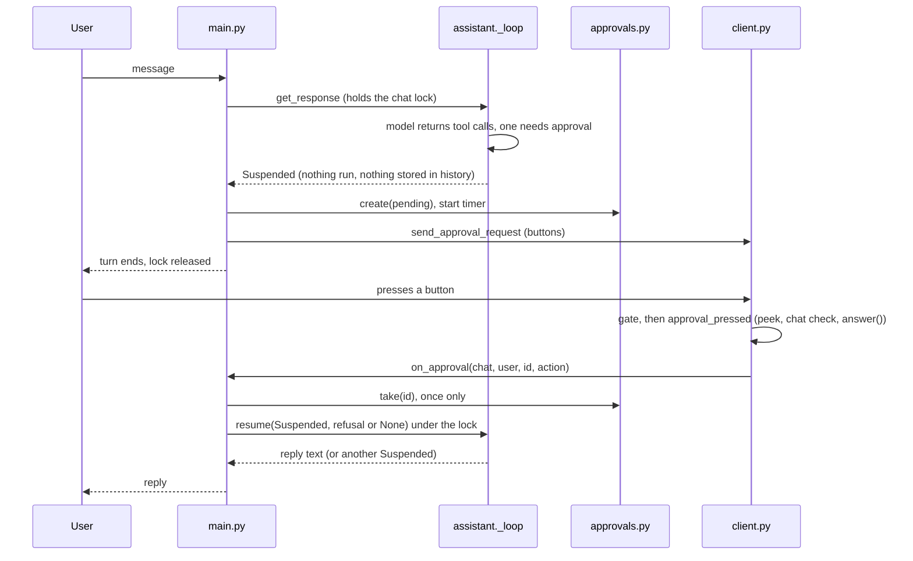

# Approval of `bash` commands (buttons in the chat)

**Read this before changing `src/approvals.py`, `assistant.Suspended` / `assistant.resume`, the approval parts of `src/main.py` and `src/client.py`, or before adding another tool that needs approval.** Built 2026-10-12 for issue #43. Design decisions are the owner's and are listed at the end.

## What the user sees

1. The model decides to call `bash`. In a chat listed in `OP_CHAT_IDS`, **nothing runs yet**. The bot sends one plain-text message listing every call of that step (a `bash` call as `$ command`, with `(in <folder>)` if `cwd` was set), with three buttons: **Approve this time** and **Deny** on one row, **Approve for the day** on its own row.
2. **Any allowed user in the chat** may press (anyone who passes the gate in `client.gate`). Not only the person who asked.
3. Approve runs every call of the step and the model carries on and answers. Deny, or no press within `approval_timeout_s` (60 s), runs nothing: the model is told so (and told not to retry) and answers.
4. The message is then edited to show the outcome (`Approved by alice.`, `Denied by alice. Nothing was run.`, `Not answered in time. Nothing was run.`) and the buttons disappear.
5. **Approve for the day** approves this step and **every later `bash` call in that chat until the next local midnight** (configured `timezone`). Those later calls run without any message; each is logged at INFO (`Running without asking, the chat approved everything for the day: ...`). **This is a serious security weakness by the owner's decision: issue #56.**

Chats that are not in `OP_CHAT_IDS` never ask: `bash` refuses to run there as before.

## How it works

- **`assistant.Suspended`** holds the model's original tool calls, its reasoning blocks, the chosen model and the number of tool rounds still allowed. **The tool-call message is not in the history while waiting**, so the stored conversation is always valid and the next request after a restart is not broken by a half-finished step.
- **`assistant.resume(instance, suspended, refusal=None)`** runs all calls (`refusal` is `None`) or answers all of them with `{"ok": false, "error": <refusal>}`. It then adds the tool round to the history and continues the same loop with the saved model and remaining steps. A resumed step can suspend again (a new request, new buttons). The daily cap is checked again on resume.
- **A step is all or nothing.** If any call in the step needs approval, **no call of that step runs** until the answer, including calls to other tools (reminders, memory) in the same step. Deny refuses all of them. This is the owner's decision for parallel calls ("ask for all three together so order isn't affected").
- **One consumer per request.** `approvals.take(id)` removes the request and cancels its timer. A press and the timer can never both act, and a second press finds nothing. `client.approval_pressed` only *peeks* (to give a "no longer valid" notice, and to refuse a press from another chat); `main.on_approval` takes.
- **The lock is not held while waiting.** The turn that asked has ended. Other messages and **reminders in that chat run normally** (a reminder takes the lock, runs its own turn and releases it). Holding the lock for the whole wait was considered and rejected: reminders are delivered one at a time (`reminders.process_due`), so one chat's lock would stall every chat's reminders, and the button press itself could not be handled (updates are processed one at a time, `docs/telegram-client.md`).
- **Messages typed while buttons are showing** are stored but not answered. The chat gets one notice (`Waiting for an answer to the approval request above...`, once per request). When the step resumes the model sees them in the history, **before** the tool round (the round is appended at the end).
- **A reminder turn that needs approval** (the model calls `bash` while wording a reminder) sends the plain `Reminder: <description>` text **immediately**, then waits like any turn. The model's own wording may follow after the answer, so a reminder can appear twice. It exists because a pending approval is lost in a restart and reminders are the one thing that must not be lost.
- **Fail closed.** If the approval message cannot be sent, the step is resumed with `NOT_ASKED_REFUSAL` and nothing runs. Nothing is left waiting (`tests/test_approval_flow.py::test_if_the_request_cannot_be_sent_...`).
- **What is shown is what runs.** The message is built from the same stored tool calls that `resume` executes. Display is cut (`approvals.MAX_MESSAGE_CHARS`, 3000 characters split between the calls, `... [cut for display, N more characters will run]`) so it fits Telegram's 4096 limit; the stored command is never cut.
- **Callback data** is `ap:<id>:<once|day|deny>`, well under Telegram's 64 byte limit. The id is `secrets.token_urlsafe(6)`.
- **Everything is in memory.** A restart forgets pending requests and day approvals. A press on an old message answers `This request is no longer valid.` (a popup from `answerCallbackQuery`). The old message keeps its buttons until someone presses one. The turn that was waiting is lost: the history ends with the user's message and no reply, the same as after an API error.

## Where each piece lives

| Piece | File |
|---|---|
| Pending store, ids, timers, day approval, display text | `src/approvals.py` |
| The `approval=True` flag and `needs_approval(name)` | `src/tools/registry.py` (`@tool(approval=True)`; only `bash` is flagged) |
| Suspend and resume, `_needs_approval` | `src/assistant.py` |
| The message with buttons, the press handler, closing the message | `src/client.py` (`send_approval_request`, `approval_pressed`, `close_approval_request`) |
| Asking, answering, expiry, holding messages, reminders | `src/main.py` (`_ask_for_approval`, `_settle`, `_resume`, `on_approval`, `_approval_expired`) |
| Setting | `config/config.yaml` `approval_timeout_s` (60) |

## Adding another tool that needs approval

1. Declare it with `@tool(approval=True)` (see [`tools.md`](tools.md)). Nothing else in the loop changes: the flag makes the whole step wait in op chats.
2. Teach `approvals.describe` how to show it. Today only `bash` has a shell-style line; anything else is shown as `name(arguments)`.
3. Tell the model in the tool's docstring that a call may be answered much later or be denied (bash's does).
4. Decide whether it should honour "approve for the day" (today the day approval applies to **every** flagged tool; #56 is about narrowing it).

## What is verified, and what is not

- **Tests (no network):** `tests/test_approvals.py` (store, expiry, midnight, display), `tests/test_assistant.py` (suspend and resume in the loop), `tests/test_approval_buttons.py` (real `telegram.Update` objects with a `callback_query` through PTB's dispatcher and the gate: an allowed user reaches the handler, a stranger is dropped and logged, a press from another chat or on a missing request is refused, the message has three buttons with valid data), `tests/test_approval_flow.py` (the whole flow through `main.py`: approve, deny, day, expiry, second press, messages while waiting, reminders, failure to send). Three deliberate breakages (a press that does not consume the request, failing open when the message cannot be sent, never suspending) were each caught by the tests.
- **Live, no Telegram (2026-10-12, Haiku 5.5, about 0.3 cent):** a real model asked for `echo` commands; the step suspended with nothing run and the lock free; Approve ran it and the model reported the output; Deny made it say it would not retry; a 2 s timeout expired and the model was told; a message typed while waiting was held, one notice sent and both answered after approval; a step with `bash` plus `list_reminders` ran neither before the press; after Approve for the day a second command ran with no request. Cache reads stayed at 97 to 99 percent of the prompt through all 16 requests.
- **Not verified: real Telegram.** That a button press arrives at the bot (`callback_query` is in PTB's default update list, and `start_polling` is called without `allowed_updates`, read from the code, not observed), that editing the message with no `reply_markup` removes the buttons (documented Telegram behaviour, not tried), and how it looks on a phone. The owner has to try it, see the list in [`verification-status.md`](verification-status.md).

## The `"null"` text problem (found and fixed 2026-10-12)

**What happened.** In the first live run, one `echo` produced three approval requests because Haiku sent `"cwd": "null"` (the four-letter *text*) instead of JSON `null` for optional arguments. The call failed validation, the model retried, and each attempt was asked about again.

**What did not help.** Persona wording. Three versions of a rule added to the `base` persona's "General Behavior" (a plain rule; a rule with the wrong form shown; a right and a wrong example side by side) each left **18 of 18** calls wrong on Haiku, the same as no rule. The edit did reach the request (checked with a marker). So the base persona was left unchanged.

**What caused it.** Bisecting the request: `bash` alone, with the full system prompt, with all function tools: 0 of 4 wrong. Adding the `openrouter:web_search` server tool: 4 of 4 wrong (`web_fetch` alone: 0 of 4). Pydantic writes `str | None` as `anyOf: [{"type": "string"}, {"type": "null"}]`. With `web_search` in the list, Claude reads that as "write the word null". The same meaning written as `"type": ["string", "null"]` was never wrong. Turning off `strict`, which also was tried, did not help.

**The fix.** `tools/registry._flatten_nullable` writes a nullable argument with one simple type as `type: [x, "null"]` (and `enum: [..., null]`). Anything more complex (a union of several types, a list) is left as Pydantic writes it. Optional arguments are still required-but-nullable, so strict mode and the tool order are unchanged. **Every chat's next request after deploy is a one-time cache write**, because the tool list changed.

**Measured on `bash` (48 calls each, full bot request with all tools, 2026-10-12):**

| Model | Schema | Valid | Text `"null"` | Malformed JSON |
|---|---|---|---|---|
| Haiku 5.5 low | before (`anyOf`) | 0 | 48 | 0 |
| Haiku 5.5 low | after (`type` list) | 48 | 0 | 0 |
| Sonnet 5.5 medium | before | 9 | 39 | 0 |
| Sonnet 5.5 medium | after | 45 | 0 | 3 |

The three malformed ones were `{"cwd": , ...}`: Sonnet left the value out. Repeating that with more calls gave 1 of 60 at medium and 4 of 60 at low effort; the old schema gave 0 of 120 malformed. So the fix trades a large problem for a small one on Sonnet. Another way to avoid both would be to make the optional arguments truly optional (not required, `strict` off); in a quick test Haiku then sent `{"command": "echo hello"}` and nothing wrong. That changes the repository's rule that every tool is strict, so it was not done.

## Known limits

- **Approve for the day approves everything** until midnight (#56, a serious weakness).
- **A call with malformed JSON arguments is still asked about** (shown as an empty command; approving it returns an error to the model). About 6 percent of Sonnet calls after the schema change below, none seen on Haiku. See [`known-issues.md`](known-issues.md).
- A restart loses a waiting turn (above). A reminder is protected by the plain-text copy.
- If the update queue is busy for the whole 60 seconds the timer can fire before a waiting press is processed, and the press then says it is no longer valid.
- The press handler runs the resumed turn inside the update, so while it runs no other chat is answered (same as any turn).
- Anyone allowed in the chat can press, including in a group. There is no check that the presser is the person who asked.

## Decisions (owner, 2026-10-12)

Buttons in the chat; any allowed user may press; three buttons (this time, the day, deny); 60 s expiry; long commands cut for display only; denial and expiry are told to the model and it is asked to answer; one approval for a whole parallel step; Approve for the day approves everything (#56); in-memory state; messages typed while waiting are held with one notice; a suspending reminder turn sends the plain reminder at once. **Design change from the first draft in `agent-parity.md`:** the first draft had `bash` return `{"awaiting_approval": true}` and re-enter later with an `API:` message; the step is now suspended instead (nothing in the history until the answer, atomic steps), which the owner approved on 2026-10-12.
