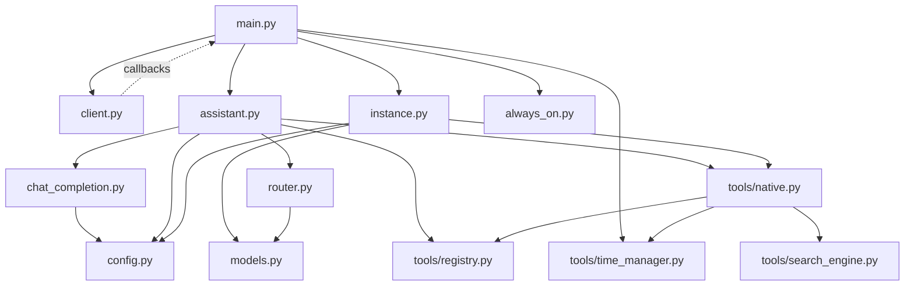
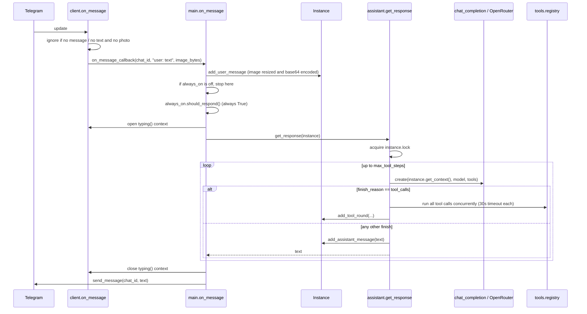

# Architecture

## Files

All code is in `src/`. Modules import each other by bare name (`import client as Client`), so `src/` must be on `sys.path` (running `python src/main.py` does this; tests do it in `tests/conftest.py`). Files are read relative to the **repository root** (`config/...`, `data/...`), so always run from the repository root.

| File | Responsibility | Imports (internal) |
|---|---|---|
| `src/main.py` | Entry point, composition, and all chat-level logic: instance registry, message and reminder handlers, command handlers, the reminder polling loop. | `client`, `assistant`, `always_on`, `instance`, `models`, `tools.time_manager` |
| `src/client.py` | Everything Telegram: receives updates, sends messages, typing indicator, registers handlers. Calls back into `main` through module-level callback variables. **Builds the Telegram `Application` at import time**, so `TELEGRAM_API_KEY` must be set before importing it. | none |
| `src/assistant.py` | The agent loop: calls the model, runs tools, stores tool rounds, handles errors and finish reasons. Also `encode_image`. | `chat_completion`, `config`, `router`, `client`, `tools.native`, `tools.registry` |
| `src/chat_completion.py` | The only module that talks to OpenRouter. Builds the request, logs one `llm_call` line per call. | `config` |
| `src/instance.py` | The `Instance` class: conversation storage, trimming, request assembly, personality loading, memory persistence. | `config`, `models` |
| `src/models.py` | The model catalogue (pinned slugs), effort levels, `ModelSpec`, `parse_model`. | none |
| `src/router.py` | `route(instance)`: stub that picks a model spec when auto routing is on. | `models` |
| `src/always_on.py` | `should_respond(context)`: stub that always returns `True`. | none |
| `src/tools/registry.py` | The tool registry: `@tool` decorator, schema generation, Pydantic argument validation, the standard result shape, `ToolContext`, `ToolError`. | `pydantic` |
| `src/tools/native.py` | The built-in tools (`save_to_memory`, `web_search`, `get_url_text`, `get_time`, `set_reminder`). Importing it registers them. | `registry`, `time_manager`, `search_engine` |
| `src/tools/time_manager.py` | `get_time`, `add_reminder`, the in-memory reminder store and `poll`. | none |
| `src/tools/search_engine.py` | `get_links` (Google Custom Search) and `get_text` (fetch and parse a page). | none |
| `src/config.py` | Loads `config/config.yaml` into the dict `config`. | none |

Not code: `config/` (settings, personalities, tool schemas), `tests/`, `unused/` (retired features, see below), `docs/`.

`unused/` holds code from features that were dropped (`casino.py`, `gif_fetcher.py`, `image_generation.py`, `dicerolls/*.mp4`). It is **not imported by anything and not maintained**. `image_generation.py` still reads `OPENAI_API_KEY`. Do not import from `unused/`.

## Dependency picture

Two things to notice:

- `client` never imports `main`. It calls **callbacks** that `main.main()` assigns at startup (`Client.on_message_callback = on_message`, and so on). This is why `client` can be tested without `main`.
- Tools do not import `client`. `assistant` hands each tool a `ToolContext` that carries the instance and the `client` module, so a tool talks to the chat through `ctx.client`. `instance` imports `tools.native` so the system prompt can list the registered tools.

## Startup sequence (`python src/main.py`)

1. `main.py` configures logging (to `app.log` and stdout).
2. `load_dotenv()` reads `.env`.
3. Imports run. **Importing `client` creates the Telegram `Application` immediately**, which raises `telegram.error.InvalidToken` if `TELEGRAM_API_KEY` is missing or empty. Importing `chat_completion` creates the OpenAI client pointed at OpenRouter. Importing `tools.native` registers the tools, and `assistant` builds the tool list from the registry. Importing `instance` reads `config/personality/index.yaml`.
4. `main()` assigns the five callbacks on `client`, then `Client.init()` starts polling Telegram.
5. A loop runs forever: `TimeManager.poll(on_reminder)` then sleep 1 second.
6. On exit, `Client.shutdown()`.

If the token is rejected by Telegram (a syntactically valid but wrong token), startup fails with `InvalidToken: Unauthorized`, followed by a second, misleading `RuntimeError: This Updater is not running!` from the shutdown in `finally`. The first error is the real one.

## What happens when a user sends a message

In words:

1. **`client.on_message`** (Telegram handler for every update). Ignores updates with no `message`. Builds the text `"<username>: <reply prefix><text or caption>"`. Downloads the photo if there is one. Ignores the update if there is neither text nor a usable photo. Then calls `on_message_callback`.
2. **`main.on_message`**. Adds the user message to the instance (resizing and base64-encoding any image). Returns early if `no_response` is set, or the chat's `always_on` flag is off, or `should_respond` says no. Otherwise runs the turn inside the typing indicator and sends the reply.
3. **`assistant.get_response`**. Described fully in [`agent-loop.md`](agent-loop.md).

The reminder path is the same from step 2: `main.on_reminder` adds an `API: The reminder '...' is up...` **user** message to the instance, runs a turn, and sends the reply.

## Concurrency model

- Everything runs on **one asyncio event loop**. There are no threads.
- python-telegram-bot is used with its default `max_concurrent_updates = 1` (verified): **updates are handled strictly one at a time**, in order. A long turn in one chat therefore blocks message handling for **all** chats until it finishes (up to many seconds, plus tool time). The per-instance `asyncio.Lock` in `get_response` is a second layer that matters only if this concurrency is ever raised, or if reminders (which run from the polling loop, not from a Telegram update) overlap with a user message.
- Within a turn, the tool calls from one model response run **concurrently** (`asyncio.gather`), each with its own timeout. Results are stored in the order the model made the calls, not the order they finished.
- The reminder polling loop and the Telegram update handler run on the same loop. A slow turn started by a reminder delays the next poll.

## Message formats at the boundaries

| Boundary | Format |
|---|---|
| Telegram to `client` | `telegram.Update` |
| `client` to `main` | `(chat_id: int, text: str, images: bytes or None, no_response: bool)`. `text` is already prefixed with `username: `. |
| `main` to `Instance` | `add_user_message(text, image_data_url)` where the image is a `data:image/jpeg;base64,...` string. |
| `assistant` to `chat_completion` | `(messages: list[dict], model: ModelSpec, tools: list[dict], chat_id, tool_choice)` |
| `chat_completion` to OpenRouter | OpenAI Chat Completions JSON plus OpenRouter fields. See [`models-and-openrouter.md`](models-and-openrouter.md). |
| `assistant` to `registry` | `registry.call(name: str, arguments: dict, ctx: ToolContext)`; returns `{"ok": true, ...}` or `{"ok": false, "error": str}`. |

## Extension points

| To change | Edit | Read |
|---|---|---|
| Add or change a tool | a `@tool` function in `src/tools/native.py` (schema, dispatch and prompt text are generated) | [`tools.md`](tools.md) |
| Change how the model is chosen per turn | `src/router.py` (keep the signature) | [`models-and-openrouter.md`](models-and-openrouter.md) |
| Change when the bot replies | `src/always_on.py` | `main.on_message` |
| Add a personality | a YAML in `config/personality/` plus an entry in `index.yaml` | [`configuration.md`](configuration.md) |
| Add a slash command | a handler in `client.py`, a callback variable, a function in `main.py`, assign it in `main.main()` | [`telegram-client.md`](telegram-client.md) |
| Change request building (cache, reasoning, headers) | `src/chat_completion.py` and `src/instance.py` | [`context-and-caching.md`](context-and-caching.md) |
